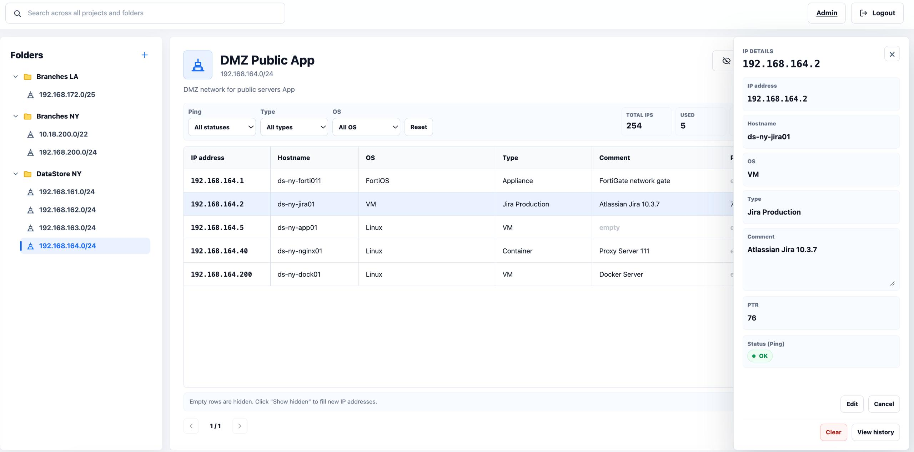

# IPtable

IPtable - простое веб-приложение для учета IP-адресов и устройств в локальной сети.
Создавайте папки и подсети, заполняйте данные об устройствах и отслеживайте их
доступность. Вся информация хранится в PostgreSQL вместо разрозненных Excel-файлов.

## Возможности

- Папки и проекты-подсети с автоматическим списком IP-адресов.
- Hostname, OS, Type, Comment и собственные столбцы с настройкой типа и порядка.
- Проверка доступности по ping сразу после создания подсети и по расписанию.
- Поиск по всем проектам, фильтры по ping, OS и Type.
- Скрытие пустых адресов, удобное редактирование и история изменений.
- Импорт и экспорт CSV/XLSX, экспорт папки в архив с возможностью задать пароль.
- Пользователи и права доступа через админ-панель.
- Русский и английский интерфейс, REST API для интеграций.



## Установка

Нужны Git, Docker и Docker Compose.

```bash
git clone https://github.com/lasnet/IPTable.git
cd IPTable
```

Откройте `docker-compose.yml`. В начале файла заполните три пустых параметра:
`POSTGRES_PASSWORD`, `SECRET_KEY` и `INITIAL_ADMIN_PASSWORD`.
Значение вида `${SECRET_KEY:-}` можно заменить своей строкой в кавычках.
Для `SECRET_KEY` используйте случайную строку длиной от 32 символов,
для пароля администратора - от 12 символов.

Затем запустите:

```bash
docker compose up -d --build
```

Откройте **http://IP-адрес-сервера:8000**. Логин по умолчанию - `admin`,
пароль - тот, который вы указали в `INITIAL_ADMIN_PASSWORD`.
База, миграции и ping-worker запускаются автоматически.

Вместо редактирования Compose можно скопировать `.env.example` в `.env`
и заполнить те же настройки там. Настройки из `.env` используются в выражениях
`${ИМЯ_ПАРАМЕТРА:-значение}`; не храните настоящий `.env` в Git.

## Настройки

Основные параметры находятся в начале `docker-compose.yml`.

| Параметр | По умолчанию | Описание |
| --- | --- | --- |
| `POSTGRES_PASSWORD` | пусто | Обязательный пароль базы данных. |
| `SECRET_KEY` | пусто | Обязательный случайный ключ сессий, от 32 символов. Сохраните его при обновлениях. |
| `INITIAL_ADMIN_USERNAME` | `admin` | Логин администратора. |
| `INITIAL_ADMIN_PASSWORD` | пусто | Пароль администратора при первом запуске, от 12 символов. |
| `APP_PORT` | `8000` | Порт приложения на сервере; задается в секции `web.ports` или в `.env`. |
| `APP_BIND_ADDRESS` | `0.0.0.0` | Адрес прослушивания; `127.0.0.1` ограничит доступ самим сервером. |
| `APP_NAME` | `IPtable` | Название приложения. |
| `INTERFACE_LANGUAGE` | `RU` | Язык интерфейса: `RU` или `EN`. |
| `POSTGRES_USER` / `POSTGRES_DB` | `iptable` | Пользователь и название базы. |
| `SESSION_IDLE_TIMEOUT_SECONDS` | `86400` | Завершение сессии после указанного числа секунд бездействия. |
| `SESSION_COOKIE_SECURE` | `false` | Для доступа по HTTPS через свой reverse proxy установите `true`. |
| `LOGIN_RATE_LIMIT_ATTEMPTS` | `5` | Сколько неудачных попыток входа допускается за окно ограничения. |
| `LOGIN_RATE_LIMIT_WINDOW_SECONDS` | `300` | Длина окна ограничения входа в секундах. |
| `LOGIN_RATE_LIMIT_LOCKOUT_SECONDS` | `900` | Время блокировки входа в секундах. |
| `PING_INTERVAL_SECONDS` | `3600` | Интервал проверки адресов в секундах. Для папок и проектов можно задать расписание в интерфейсе. |
| `PING_TIMEOUT_SECONDS` | `2` | Сколько секунд ждать ответа одного адреса. |
| `PING_CONCURRENCY` | `8` | Максимум одновременных ping внутри одного worker. |
| `PING_BATCH_SIZE` | `32` | Сколько адресов проверять одним пакетом. |
| `PING_BATCH_PAUSE_SECONDS` | `1` | Пауза между пакетами. |
| `PING_PROJECT_PAUSE_SECONDS` | `5` | Пауза между подсетями. |
| `PING_QUEUE_POLL_SECONDS` | `5` | Интервал чтения очереди worker. |
| `PING_RUNNING_JOB_TIMEOUT_SECONDS` | `7200` | Когда возвращать зависшую ping-задачу в очередь. |
| `PROJECT_TABLE_DEFAULT_PAGE_SIZE` | `25` | Количество строк на странице таблицы. |
| `MAX_PROJECT_ADDRESSES` | `4096` | Максимум адресов в одной подсети. |
| `CSV_IMPORT_MAX_BYTES` | `2097152` | Максимальный размер CSV/XLSX-файла в байтах. |
| `INTEGRATION_API_TOKEN` | пусто | Токен REST API. Без него API отключен. |
| `APP_ENV` | `production` | Рабочий режим с отключенными Swagger/OpenAPI; `local` используется при разработке. |
| `DATABASE_URL` | пусто | Необязательное подключение к существующей БД. Для встроенной PostgreSQL заполнять не нужно. |

Пароли и логин при первом запуске создают учетные записи.
Изменение `INITIAL_ADMIN_PASSWORD` или `POSTGRES_PASSWORD` в конфигурации
не меняет пароль уже созданного пользователя или базы. Пароли пользователей
меняются в админ-панели. Для HTTP внутри локальной сети подходит стандартный запуск;
при доступе через интернет используйте HTTPS.

## Первые шаги

Создайте папку, добавьте проект с подсетью, например `192.168.1.0/24`,
и нажмите «Показать скрытые». Нажмите на строку IP, выберите «Редактировать»
и заполните данные устройства. Статусы ping: `NoTest` - еще не проверялся,
`OK` - доступен, `NO` - не отвечает.

Для импорта используйте CSV с разделителем `;` или XLSX с колонками
`ip;hostname;os;type;comment`. Строка заголовка необязательна.

## Обновление и основные команды

Перед обновлением сохраните свои настройки Compose или `.env` и сделайте резервную копию.

```bash
scripts/backup_postgres.sh
git pull --ff-only
docker compose up -d --build
```

Если настройки внесены прямо в Compose, Git может попросить объединить их с новой
версией файла. Отдельный `.env` позволяет обновлять Compose без этого конфликта.

```bash
docker compose ps              # состояние сервисов
docker compose logs -f web     # логи приложения
docker compose logs -f worker  # логи ping
docker compose down            # остановка с сохранением базы
```

Данные хранятся в Docker volume. Для восстановления из копии:

```bash
docker compose stop web worker
CONFIRM_RESTORE=YES scripts/restore_postgres.sh backups/имя_копии.dump
docker compose start web worker
```

Не используйте `docker compose down -v`, если хотите сохранить данные.
Если изменили настройки, примените их через `docker compose up -d`.

Лицензия: [MIT](LICENSE).
